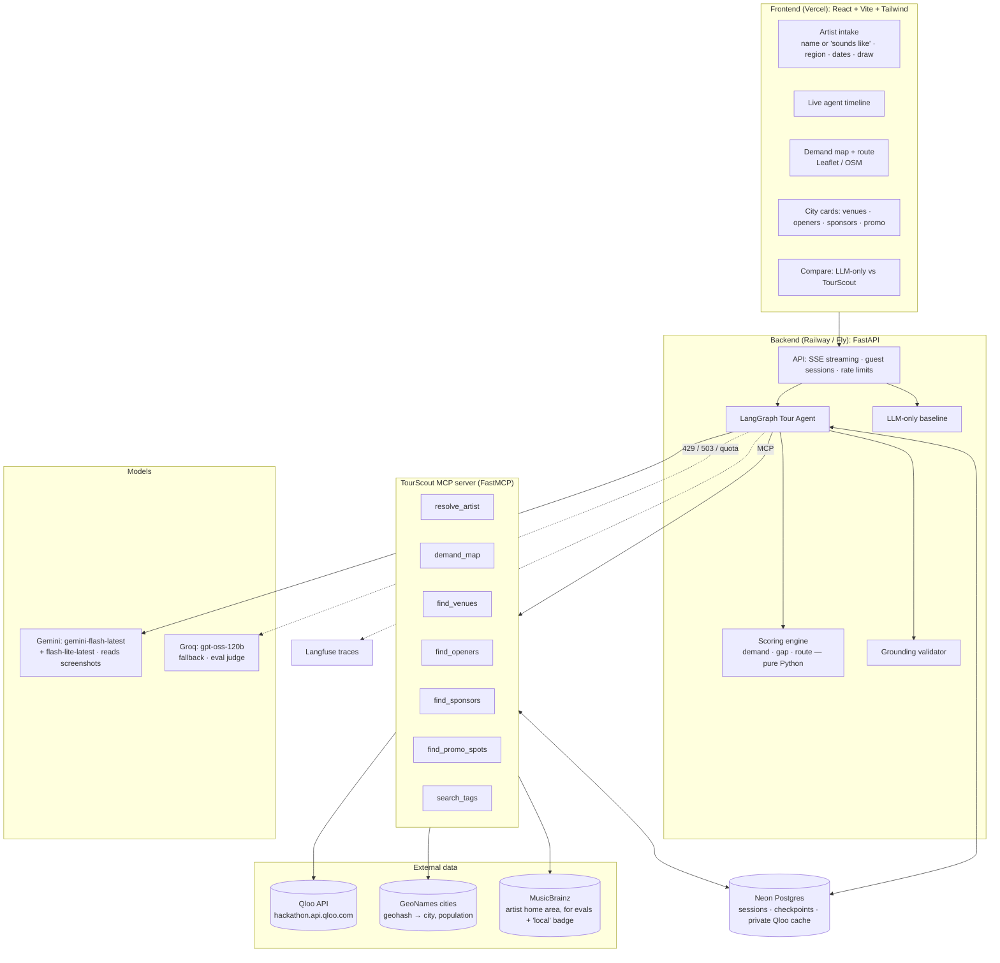
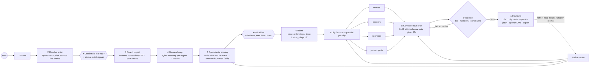
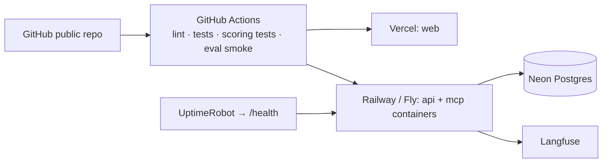

# TourScout: Architecture

> **TourScout is a tour-planning agent for independent musicians.**
> It shows an indie artist where they have **unserved demand**, which **local openers** would actually pull a crowd, which
> **venues** fit their audience, and which **brands** their fans love enough to sponsor a show. Labels pay analysts
> for this; TourScout gives it to independent artists, grounded in Qloo's taste graph.

---

## 0. The problem → what Qloo uniquely gives us

| An indie artist today… | Why an LLM alone fails | What Qloo gives TourScout (verified in Phase 1) |
|---|---|---|
| guesses cities from last year's streams + gut feel | it knows big cities, not where *this* sound's fans cluster | **Heatmap**: `filter.type=urn:heatmap` + artist signal → ~2,500 geohash cells with `affinity` and `popularity` for the US alone; it also works inside a region (Texas → 384 cells) |
| can't see unserved demand | it has no data on the artist's current reach | Qloo demand **minus** the artist's own reach (streaming top cities, past shows) = the gap |
| picks openers they already know | it invents or names famous acts | `urn:entity:artist` + `signal.location.query=<city>` + high `signal.location.weight` + `filter.popularity.max` → for Men I Trust in Chicago it returned Divino Niño, Knox Fortune, Sen Morimoto, NNAMDÏ, KAINA, **all actual Chicago acts** |
| finds venues by word of mouth | it can't rank venues by audience fit | `urn:entity:place` + `filter.tags=urn:tag:category:place:live_music_venue` + artist signal → Lincoln Hall, Thalia Hall, Concord, Los Globos, Reggies, each with rating, hours, address and coordinates |
| has no sponsor deck | brand guesses aren't evidence | `urn:entity:brand` + artist signal (+ city) → ranked by affinity (Urban Outfitters, Dr. Martens, Polaroid… and in Chicago: Herschel, VSCO) |

**If you remove Qloo, every one of these steps loses its evidence.** That's the hackathon's own test.

---

## 1. Design principles

1. **Qloo is the source of truth; the LLM reasons and writes.** Every venue, opener and brand in the output must be a Qloo entity ID returned in this run. A validator enforces it.
2. **Code computes numbers, the LLM explains them.** Demand scores, the unserved-demand gap, routing distances and rankings are deterministic Python. The LLM never invents a number; it may only quote numbers given to it.
3. **Honest about gaps.** Qloo has no venue capacity or booking data. The UI says "capacity: verify" instead of guessing; the artist can enter their typical draw.
4. **Agent, not a pipeline.** A LangGraph agent decides which tools to call, asks the artist at checkpoints (human-in-the-loop), and handles refinement ("skip Texas", "only rooms under 500").
5. **Reusable capability.** All Qloo access goes through a **TourScout MCP server**, so Claude Desktop or any MCP agent can ask "where should Hovvdy tour in the Midwest?". That also covers the hackathon's "wire Qloo into an existing agent" track.

---

## 2. System overview



---

## 3. The agent (LangGraph)



### Node responsibilities
| # | Node | LLM? | What it does |
|---|---|---|---|
| 1 | Intake | lite | Parses free text into: artist name or "sounds like" list, home base, region(s), tour window, number of shows, typical draw (cap range), budget, past cities |
| 2 | Resolve | – | `resolve_artist`. If the artist isn't in Qloo, resolves 2–5 "sounds like" artists and uses them as the taste signal (and says so in the UI) |
| 3 | Reach ingest | main (vision) | Optional. Gemini reads a screenshot of the artist's streaming dashboard (top cities + listeners) or a CSV. Past show cities count as "served" |
| 4 | Demand map | – | `demand_map(artist_ids, region)`: heatmap cells → aggregated to metros |
| 5 | Scoring | – | Deterministic scoring (§5): demand, reach, gap → `unserved` / `proven` / `low` |
| 6 | Route | – | Orders the chosen cities: nearest-neighbour + 2-opt on haversine × road factor; respects max drive per day and days off |
| 7 | Fan-out | – | Parallel per city: `find_venues`, `find_openers`, `find_sponsors`, `find_promo_spots` |
| 8 | Compose | main | Writes the tour brief: why each city, best venue + opener per date, sponsor angle. Uses only IDs and numbers given |
| 9 | Validate | – | Every entity ID ∈ fetched candidates; every quoted number ∈ computed numbers; dates/drive constraints hold |
| 10 | Outputs | main | Sponsor pitch email per brand, opener outreach DM, CSV/ICS export |

### Agent state (conceptual)
| Field | Holds |
|---|---|
| `artist` | Qloo ID or null, name, popularity, `signal_ids` (self or sounds-like), `on_qloo` flag |
| `constraints` | region(s), window, n_shows, draw range, max_drive_km, home base, budget |
| `reach` | city → listeners/fans (from screenshot/CSV), `served_cities` (past shows) |
| `metros[]` | metro, lat/lon, population, demand, reach, gap, label |
| `route[]` | ordered stops with dates and drive km |
| `city_intel{metro}` | venues[], openers[], sponsors[], promo_spots[] (all Qloo entities) |
| `brief` | composed output (schema-validated) |
| `validation` | violations, retry count |
| `trace` | events streamed to the UI |

Checkpointed in Postgres (LangGraph checkpointer), so refinement continues the same run.

---

## 4. TourScout MCP server: tool catalog

| Tool | Qloo calls (verified params) | Returns (trimmed) |
|---|---|---|
| `resolve_artist(name)` | `GET /search?query=&types=urn:entity:artist&take=5` | candidates: id, name, popularity, genre tags |
| `search_tags(query)` | `GET /v2/tags?filter.query=` | tag id, name, type, parent entity types |
| `demand_map(signal_ids, region)` | `GET /v2/insights?filter.type=urn:heatmap&signal.interests.entities=&filter.location.query=<region>`; several IDs blend (sounds-like path); a city region returns geohash-7 hot spots; regions like "Midwest" expand to states, queried in parallel, border cells de-duplicated | top metros: name, lat/lon, population, demand, cell count |
| `find_venues(signal_ids, city, take)` | `filter.type=urn:entity:place`, `filter.location.query=<city>`, `filter.tags=urn:tag:category:place:live_music_venue` **and** `urn:tag:setting:qloo:music_venue` (two calls, merged), `signal.interests.entities`. Never `filter.popularity.max` (pulls in restaurants) | id, name, address, lat/lon, rating, hours, affinity, popularity |
| `find_openers(headliner_id, cities[])` | `filter.type=urn:entity:artist`, `signal.interests.entities`, `signal.location.query=<city>`, `signal.location.weight=<high>`, `filter.popularity.max=<headliner − 0.05>` (headliner popularity via `GET /entities?entity_ids=`), `filter.exclude.entities=<headliner>`, `take=20` per city, in parallel | id, name, affinity, popularity, genre tags, *fit* (genre-tag overlap with the headliner), *local badge* (MusicBrainz), *national* flag (tops ≥ 3 cities) |
| `find_sponsors(signal_ids, city?)` | `filter.type=urn:entity:brand`, `signal.interests.entities`, optional `signal.location.query` | id, name, affinity (national and city), uplift |
| `find_promo_spots(signal_ids, city)` | `urn:entity:place` with `urn:tag:category:place:{record_store,book_store,coffee_shop,bar}`; drop results with no address | id, name, address, affinity |

Tool-layer rules:
- Base `https://hackathon.api.qloo.com`, header `X-Api-Key`, GET only.
- **Allow-list of params per `filter.type`** (Qloo silently ignores invalid ones). Example found in Phase 1: `filter.location.query` is *ignored* for artists; you must use `signal.location.query`.
- Trim verbose fields (`akas`, `disambiguation`, hours detail when not needed) before returning to the LLM.
- Private Postgres cache keyed by `hash(path + sorted params)`. **Never commit Qloo data.**
- Heatmap calls are the slowest (1.5–4 s, ~2,500 cells), so cache them aggressively and aggregate server-side.

---

## 5. Scoring engine (deterministic, unit-tested)

Heatmap cells are geohash-4 squares (≈ 40 × 20 km). Each has `affinity` (taste match for the artist's signal, 0–1) and
`popularity` (how much Qloo activity the cell has, 0–1). Affinity alone favours tiny, empty cells (the Prateek Kuhad India map
ranked remote Ladakh first), so we always weight by size.

1. **Cells → metros:** map each cell to the nearest GeoNames city with population ≥ 100k within 50 km. Metro demand =
   popularity-weighted mean of cell affinity, plus the summed popularity as an audience-size proxy.
2. **Demand score** `D = affinity_w × log10(population)`, normalised 0–100 within the region.
3. **Reach score** `R` (0–100) from the artist's own data: streaming listeners per city (screenshot/CSV) and recency of past shows. Without data, `R = 0` and every city reads as "potential".
4. **Gap** `= D − R`. Labels:
   - **Unserved demand**: D high, R low → the headline insight
   - **Proven**: D high, R high → anchor dates
   - **Low priority**: D low
5. **Openers:** rank = `0.6 · fit + 0.4 · local pull`. *fit* = Jaccard overlap of Qloo genre tags with the headliner (a
   no-location run was tried in Phase 2 and contained none of the local acts); *local pull* = the opener's affinity
   min-max scaled within the city. MusicBrainz adds +0.15 for "based here" and −0.25 for "based elsewhere". Drop acts flagged *national* (they top ≥ 3 cities: Jack Antonoff did in Phase 1). The MusicBrainz badge says
   "based here" or "popular here".
6. **Route:** pick N cities by gap (plus anchors) under constraints, then order them by nearest-neighbour + 2-opt on haversine distance × 1.25 road factor. A leg over `max_drive_km` inserts a day off or drops the city with the lowest gap.

All formulas live in one module with unit tests. The weights are constants we tune in Phase 7 using the backtest.

---

## 6. Model routing

| Job | Model | Notes |
|---|---|---|
| Agent reasoning, compose, sponsor pitch, outreach DMs | Gemini `gemini-flash-latest` | tool calling + structured output |
| Intake parsing, refine-router, formatting | Gemini `gemini-flash-lite-latest` | saves main quota; alias confirmed in the model list |
| Streaming-dashboard screenshot → cities + listeners | Gemini Flash (image input) | structured output; the user confirms the extracted table |
| Fallback for every text step | Groq `openai/gpt-oss-120b` | on 429 / 503 / quota **or a fast-fail timeout (≈ 8 s, one retry)**. Phase 1: the whole Gemini Flash family returned 503 all day and lite took 21–33 s, while Groq answered tool calls in ~1 s |
| Eval judge | Groq `openai/gpt-oss-120b` | different model family from the generator |

Rules: model names live in config; every trace logs the resolved `modelVersion`; if Gemini is down, the screenshot upload says "enter your top cities instead".

---

## 7. Request flow

```mermaid
sequenceDiagram
    participant A as Artist
    participant FE as Frontend
    participant AG as Agent (FastAPI + LangGraph)
    participant M as MCP tools
    participant Q as Qloo
    participant L as Gemini (Groq fallback)

    A->>FE: "Hovvdy, Midwest, 10 shows in April, rooms 300–600" + streams screenshot
    FE->>AG: POST /api/chat (SSE)
    AG->>L: parse intake; read screenshot → top cities
    AG->>M: resolve_artist("Hovvdy")
    M->>Q: /search
    AG-->>FE: ⏸ confirm artist
    AG->>M: demand_map(ids, "Midwest" states)
    M->>Q: /v2/insights urn:heatmap (per state, parallel)
    AG->>AG: score metros, gap vs streams
    AG-->>FE: map + ranked cities (unserved / proven) ⏸ pick
    AG->>AG: route (code)
    par per city
        AG->>M: find_venues / find_openers / find_sponsors / find_promo_spots
        M->>Q: /v2/insights (place, artist, brand)
    end
    AG->>L: compose brief (only these IDs + numbers)
    AG->>AG: validate → retry if needed
    AG-->>FE: tour plan, city cards, sponsor pitches, opener DMs, export
```

---

## 8. Backend surface

| Method | Path | Purpose |
|---|---|---|
| POST | `/api/sessions` | guest session → `thread_id` |
| POST | `/api/chat` | message + optional upload refs → **SSE** agent events |
| POST | `/api/resume` | answer a checkpoint (confirm artist, pick cities) |
| POST | `/api/upload` | screenshot/CSV → temporary ref (deleted after parsing) |
| POST | `/api/compare` | the LLM-only baseline for the same request |
| GET | `/api/personas` | one-click demo artists |
| GET | `/api/export/{thread_id}.{csv,ics}` | tour plan export |
| GET | `/health` | uptime ping |
| — | `/mcp` | public, rate-limited TourScout MCP endpoint |

---

## 9. Repository layout

```
Tourscout/
├── LICENSE · README.md · PLAN.md · ARCHITECTURE.md · .env.example
├── apps/
│   ├── web/                     # React + Vite + Tailwind
│   └── api/                     # FastAPI + LangGraph
│       ├── agent/               # graph, nodes, state, prompts
│       ├── scoring/             # demand, gap, route (pure, unit-tested)
│       ├── baseline/            # LLM-only planner
│       └── routes/ · core/
├── packages/
│   └── tourscout_mcp/           # FastMCP server, Qloo client, param allow-lists, GeoNames + MusicBrainz helpers
├── data/                        # GeoNames download script (data/raw/ git-ignored)
├── evals/                       # personas, metrics, backtest, reports (numbers only)
├── scripts/                     # Phase 1 explorers (check_keys, qloo_explore)
├── docs/                        # notes, runbooks, prompts, wireframes, scoring, diagrams
└── infra/                       # Dockerfiles, deploy config
```

---

## 10. Data, privacy and licences
- **Qloo:** private server-side cache only (allowed by the hackathon guide); nothing in git.
- **GeoNames** `cities15000` (CC BY 4.0): downloaded at build time, credited in the README.
- **MusicBrainz** (core data CC0): artist home area for the "local" badge and evals. Respect 1 request/second and send a User-Agent.
- **setlist.fm API** (evals only, free key, non-commercial): past tours for the backtest.
- **Artist uploads:** parsed in memory, then deleted. No accounts; sessions expire.

---

## 11. Deployment


No cold starts (judges leave if they see a spinner). Pre-warmed cache for demo artists. Per-IP, per-session and global daily caps protect the Qloo and Gemini quotas.

---

## 12. Quality: guardrails, observability, evals
- **Guardrails:** schema-validated outputs; ID and number grounding; upload size/type limits; user text treated as data (prompt-injection hygiene).
- **Observability:** Langfuse spans for every node and tool call; the UI timeline mirrors them.
- **Evals** (details in `evals/README.md`):
  1. **Opener locality**: % of suggested openers actually based in that city (MusicBrainz), TourScout vs LLM-only.
  2. **Opener fit**: % of suggested openers smaller than the headliner (Qloo popularity) and in a matching genre.
  3. **Venue grounding**: % of venues that exist (TourScout 100% by construction; LLM-only checked via Qloo `/search`).
  4. **Backtest**: for real indie artists' past tours (setlist.fm), what share of the cities they played rank in TourScout's top-N demand metros, vs a population-only baseline.
  5. **Sponsor relevance**: blind pairwise LLM judge plus a small human panel.
  6. **Latency and cost** per tour plan.
