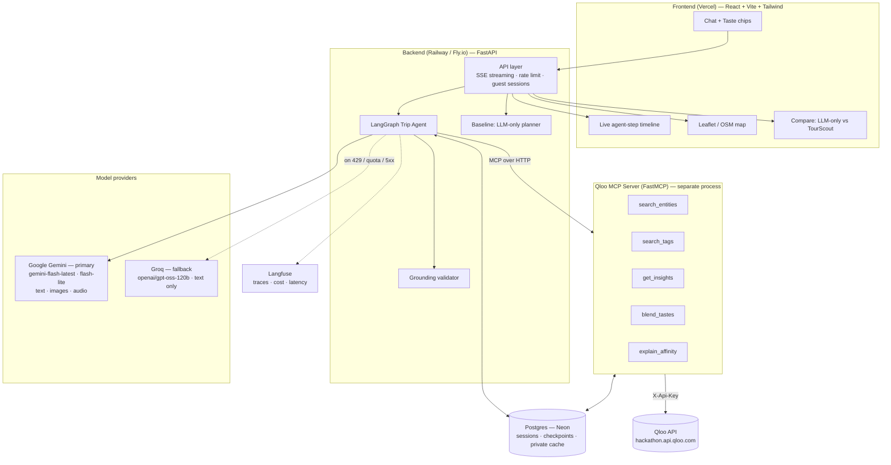
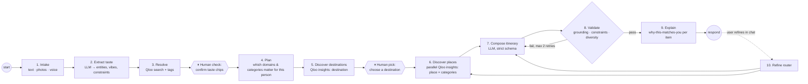
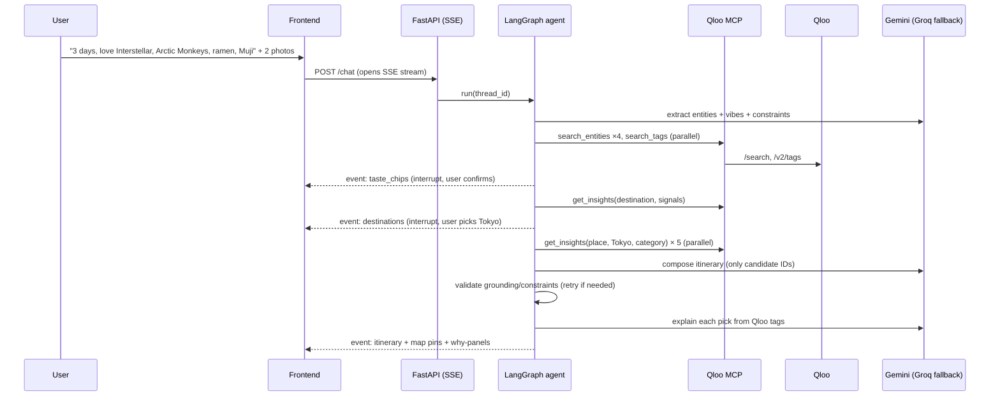
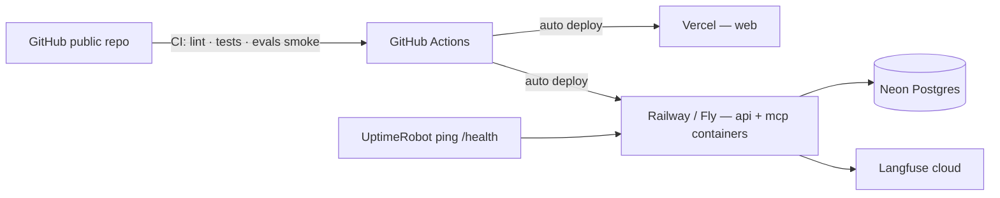

# TourScout: Architecture

> A taste-grounded travel agent. It plans trips (solo or group) from what people actually love,
> using Qloo's taste graph as the source of truth and Google Gemini (with Groq as fallback) for reasoning, vision and language.

---

## 0. Design principles (what the judges asked for, turned into rules)

| Hackathon requirement | Architectural rule |
|---|---|
| "Agentic tool / agent framework / wire Qloo into an existing agent" | **LangGraph** agent **and** a standalone **Qloo MCP server**. The same tools plug into our agent *and* into Claude Desktop / any MCP client. That covers two of the three allowed shapes. |
| "If it works the same without Qloo, you're building the wrong thing" | **Grounding contract:** the agent may only recommend entities Qloo returned. A validator node enforces it. A built-in **"LLM-only vs TourScout" compare mode** shows the difference live. |
| "Functional demo, externally hosted, end-to-end" | Guest mode (no login), cold-start-free hosting, pre-warmed demo personas, per-IP rate limits so judges never hit a dead app. |
| "Public repo, all source + instructions, OSS license" | Monorepo, MIT `LICENSE`, one-command local run, `.env.example`. **No Qloo response data committed** (Qloo terms). |

---

## 1. System overview



**Why an MCP server instead of plain functions?**
1. It decouples the "taste capability" from the agent, so it can be tested, versioned and deployed independently.
2. It fulfils the "wire Qloo into an agent you already have" track for free: a judge can add TourScout's MCP URL to Claude Desktop and ask for taste-grounded recommendations.
3. It's a strong resume signal: "designed and shipped an MCP server" is a concrete, current agent-engineering skill.

---

## 2. The agent (LangGraph state machine)



**Group mode:** step 2 runs once per traveller and step 3 adds a **Blend** node. Each person's Qloo signals are queried separately and together, and destinations and places are ranked by the *minimum* (fairness) or *mean* affinity across members. The UI shows a per-person satisfaction bar. An LLM-only planner can't do this credibly, so this is our headline feature.

### Agent state (conceptual)
| Field | Holds |
|---|---|
| `travellers[]` | per person: raw input, resolved Qloo entity IDs, tag IDs, vibe labels |
| `constraints` | days, budget, pace, dietary, accessibility, dates, origin |
| `plan` | categories to fetch + weights (e.g. foodie → more restaurants) |
| `destinations[]` | Qloo results + affinity + supporting tags |
| `candidate_places{category: []}` | Qloo place results with lat/lng, tags, affinity |
| `itinerary` | days → slots → `place_id` (must exist in candidates) |
| `validation` | grounding %, constraint violations, retry count |
| `trace` | step events streamed to the UI |

Checkpointed in Postgres via the LangGraph checkpointer, so refinement turns resume state instead of starting over.

---

## 3. Tool catalog (Qloo MCP server)

| Tool | Wraps | Purpose |
|---|---|---|
| `search_entities(query, types)` | `GET /search` | name → Qloo entity ID (movie, artist, book, brand, tv_show, podcast, video_game, place, destination) |
| `search_tags(query, type?)` | `GET /v2/tags` | free words / vibe labels → valid tag URNs |
| `get_insights(filter_type, signals, filters, take)` | `GET /v2/insights` | core recommender; used for `urn:entity:destination` and `urn:entity:place` |
| `blend_tastes(profiles[], filter_type, filters)` | multiple `/v2/insights` | per-person and joint affinity → fairness-ranked list |
| `explain_affinity(entity_id, signals)` | `/v2/insights` tag metadata | returns the tags/overlaps that justify a recommendation (feeds the "why" text) |

Tool-layer rules (from the Qloo hackathon guide):
- Base URL `https://hackathon.api.qloo.com`, header `X-Api-Key`, GET with query params only.
- Tags and audiences must be real Qloo IDs: always resolve through `search_tags` first.
- Invalid params are **silently ignored**, so the tool layer validates params per `filter.type` against our own allow-list (built in Phase 1).
- Trim verbose fields (`akas` etc.) before returning to the LLM to save tokens.
- Cache privately in Postgres (allowed with no TTL limit); never commit the cache.

---

## 4. Model routing

Two providers only: **Google AI Studio (Gemini)** as primary and **Groq** as fallback. Hugging Face is no longer needed,
because Gemini covers images and audio itself. That means one less key and one less thing to break.

| Job | Model | Notes |
|---|---|---|
| Agent steps: extract, plan, tool calling, compose, explain | Gemini `gemini-flash-latest` (today → 3.8 Flash) | tool calling + structured output; built for long multi-step agent work |
| Cheap steps: routing, refine-intent, summarising, formatting | Gemini `gemini-3.5-flash-lite` | protects the main model's daily quota |
| Photos → vibe labels | Gemini Flash (image input) | structured output restricted to our ~40 vibe labels → mapped to Qloo tag URNs |
| Voice → text | Gemini Flash (audio input) | no separate speech model |
| Fallback for every text step | Groq `openai/gpt-oss-120b` | production model, tool calling, ~1,000 req/day free; triggered on Gemini 429 / quota / 5xx |
| Text ↔ tag semantic match | `all-MiniLM-L6-v2` (runs locally) | zero cost; ranks candidate tags from `/v2/tags` |
| Eval judge | Groq `openai/gpt-oss-120b` | a different model family from the generator, so it's less likely to favour its own outputs |

**Model-layer rules**
- **Alias in production, logged version everywhere.** `gemini-flash-latest` protects the live demo if a numbered 3.x Flash is retired during judging. Every trace and eval report records the *resolved* model version, so behaviour changes stay explainable.
- **Graceful multimodal degradation:** Groq is text-only. If Gemini is down, photo and voice inputs show "type your vibe instead" while the core agent keeps working.
- **Do not use:** Gemini Pro (paid only), `gemini-2.5-flash` (old), Groq `llama-3.3-70b-versatile`, `llama-3.1-8b-instant`, `qwen/qwen3-32b`, `llama-4-scout` (being deprecated on the free tier), and Groq Compound (shut down).
- Model names live in config, not code. Phase 0 confirms names and free-tier limits by listing models from both APIs.
- If Google offers a `-latest` alias for Flash-Lite, use it too (it's also a numbered model).

---

## 5. Request flow (solo trip, happy path)



The UI renders every event in a **live agent timeline** ("🔎 Resolving 'Arctic Monkeys' → artist …", "📍 Fetching cafés in Tokyo …"), so judges can watch the agent use Qloo.

---

## 6. Backend surface (our API)

| Method | Path | Purpose |
|---|---|---|
| POST | `/api/sessions` | create guest session → `thread_id` |
| POST | `/api/chat` | user message (+ optional image/audio refs); **SSE** stream of agent events |
| POST | `/api/resume` | answer an interrupt (confirm chips, pick destination) |
| POST | `/api/upload` | images/audio → temp storage ref |
| POST | `/api/compare` | same request to the LLM-only baseline, returned side by side |
| GET  | `/api/personas` | pre-built demo personas (one-click try) |
| GET  | `/health` | liveness for uptime pings |
| — | `/mcp` | Qloo MCP server endpoint (streamable HTTP), public, rate-limited |

---

## 7. Repository layout

```
Tourscout/
├── LICENSE                     # MIT (shows in GitHub "About")
├── README.md                   # pitch, live links, how Qloo is used, run locally, eval results
├── PLAN.md / ARCHITECTURE.md
├── .env.example
├── apps/
│   ├── web/                    # React + Vite + Tailwind frontend
│   └── api/                    # FastAPI + LangGraph agent
│       ├── agent/              # graph, nodes, state, prompts
│       ├── baseline/           # LLM-only planner for comparison
│       ├── routes/
│       └── core/               # config, db, rate limit, logging
├── packages/
│   └── qloo_mcp/               # FastMCP server + Qloo client + param allow-lists
├── evals/
│   ├── personas/               # 25–30 test personas (inputs only, no Qloo data)
│   ├── metrics/                # grounding, constraints, diversity, judge
│   └── reports/                # generated summaries (numbers only)
├── docs/
│   ├── qloo-notes.md           # Phase 1 findings: which params work per type
│   ├── diagrams/               # exported PNGs for README / Devpost
│   └── mcp-claude-desktop.md   # how to plug the MCP server into Claude
└── infra/                      # Dockerfiles, railway/fly config
```

---

## 8. Data, caching and storage
- **Postgres (Neon free):** guest sessions, LangGraph checkpoints, Qloo response cache (key = hash of endpoint + sorted params), tag mapping table (vibe label → tag URN).
- **Uploads:** kept in memory / temp only and deleted after processing. No personal data is stored beyond the session.
- **Demo personas:** their Qloo results are pre-warmed into the *private* cache at deploy time, so they're fast and survive rate limits.

---

## 9. Deployment



- Avoid free tiers that sleep (cold start = a judge sees a spinner and leaves). Use Railway/Fly small instances, or keep-alive pings.
- Secrets live only in the platform env vars.
- Per-IP and per-session rate limits plus a global daily cap protect the Qloo and Groq quotas.

---

## 10. Quality: guardrails, observability, evals
- **Guardrails:** schema-validated LLM outputs; grounding validator; prompt-injection hygiene (user text never becomes tool params without validation); content moderation on free text.
- **Observability:** Langfuse traces per run (each node, tool call, token use, latency). Screenshots go in the README.
- **Evals (the resume centrepiece):** the same 25–30 personas run through **TourScout vs an LLM-only baseline**.
  - *Grounding rate*: % of recommended venues that are real, resolvable entities.
  - *Constraint satisfaction*: days, budget, dietary, pace.
  - *Taste relevance*: blind LLM-as-judge pairwise preference plus a small human check (teammates/friends).
  - *Group fairness*: min per-person affinity in group mode.
  - *Latency / cost per trip.*
  Results go in a table in the README: hard evidence that "it only works because of Qloo".
