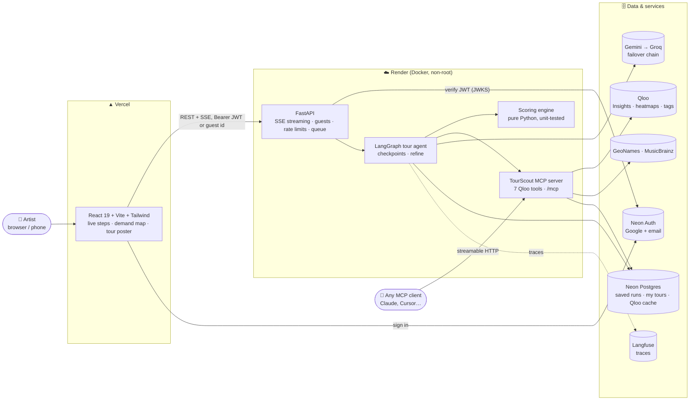
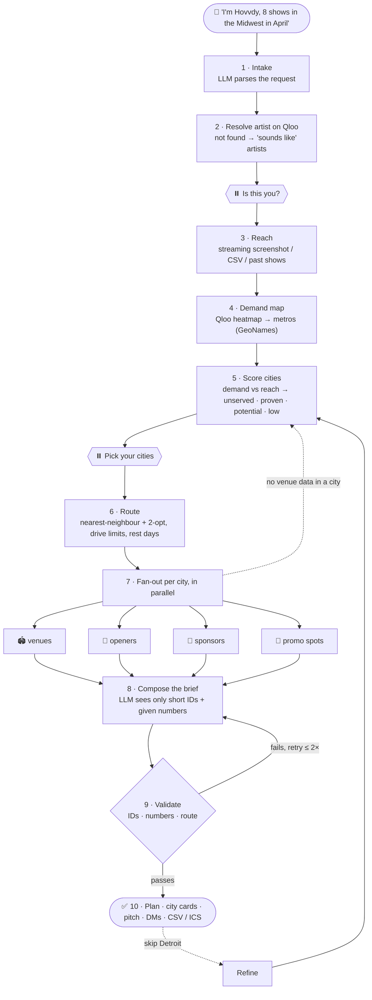
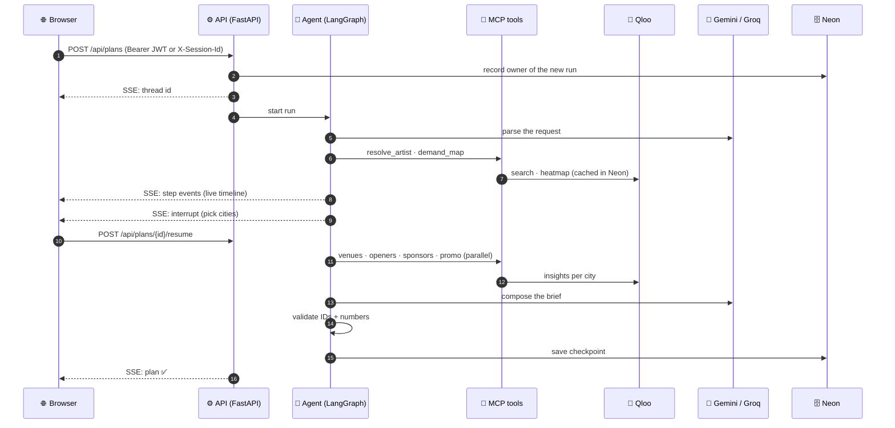

<div align="center">

# 🎸 TourScout 🗺️

### Plan your next tour where your fans actually are.

**An AI agent for independent musicians, grounded in [Qloo](https://www.qloo.com)'s taste graph.**

[](https://tourscout-lovat.vercel.app)
[](#-use-the-qloo-tools-from-any-ai-agent-mcp)


</div>

---

## 🔗 Links

| | |
|---|---|
| 🌐 **Live app** | **https://tourscout-lovat.vercel.app** (plan as a guest, or sign in with Google / email) |
| ⚙️ **API** | https://tourscout-api.onrender.com · health: [`/health`](https://tourscout-api.onrender.com/health) |
| 🔌 **MCP endpoint** | `https://tourscout-api.onrender.com/mcp` (streamable HTTP, no key) |
| 📐 **Architecture (in depth)** | [ARCHITECTURE.md](ARCHITECTURE.md) |

> The API runs on Render's free tier. If nobody has used it for a while, the first plan can take ~50 s to wake it up.

---

## 🎯 The problem

A mid-sized indie artist usually picks tour cities from last year's streams and gut feel. They can't see:

- 📍 where they have **unserved demand**: cities full of people with their taste who've never seen them live,
- 🎤 which **local opener** would actually pull a crowd in each city,
- 🤝 which **brands** their fans love enough to sponsor a show.

Labels pay analysts for this. Independent artists can't. **TourScout is that analyst.**

## ✨ What it does

| | |
|---|---|
| 🔥 **Demand map** | Where fans of your sound are (Qloo heatmap), compared with where you already have listeners → **unserved cities** |
| 🚐 **Routed tour** | Dates in order, drive distances, travel and rest days, within your date window and max drive per day |
| 🏟️ **Every stop** | Venues that fit your audience, **local openers** smaller than you who pull that crowd, promo spots, **sponsor brands** your fans over-index on |
| ✉️ **Ready to send** | A sponsor pitch and an opener DM quoting real affinity numbers, plus CSV and calendar (.ics) export |
| 🔁 **Change it** | "Skip Detroit", "only 6 shows", "max 400 km a day": the agent re-plans just what's needed |
| 🆚 **Compare** | The same request to an LLM with no tools, side by side, so you see what Qloo adds |
| 👤 **Accounts (optional)** | Sign in with Google or email to keep **My tours** on every device; guest tours move into the account |

---

## 🏗️ Architecture



**Design rules**
1. 🧭 **Qloo is the source of truth; the LLM only reasons and writes.** Every venue, opener and brand in a plan is a Qloo entity returned in that run. A validator enforces it.
2. 🧮 **Code computes the numbers, the LLM explains them.** Demand, the unserved gap, routes and rankings are deterministic Python. The LLM can only quote numbers it was given.
3. 🙋 **Honest about gaps.** Qloo has no venue capacity data, so the app says "capacity: verify" instead of guessing.
4. 🔌 **Reusable.** All Qloo access goes through the TourScout MCP server, so any AI agent can use the same tools.

---

## 🔄 Agent workflow



The two ⏸️ steps are **human-in-the-loop checkpoints** (LangGraph `interrupt`). Turn on "Let me confirm" to answer them, or let the agent pick. Runs are saved in Postgres, so a checkpoint, a refine or a reload continues the same run.

### How a city gets scored
| Step | What happens |
|---|---|
| **Cells → metros** | Qloo heatmap cells (~40 × 20 km) join the city with the strongest pull (population ÷ distance²) within 50 km |
| **Demand (0–100)** | Affinity shrunk toward the regional mean (one hot cell can't beat Chicago), × log₁₀(population), scaled |
| **Reach (0–100)** | 100 · √(listeners ÷ your top city), at least 60 if you played there in the last year |
| **Label** | **Proven** if reach ≥ 50 · **Low** if demand < 35 · **Unserved** if demand ≥ 60 and demand − reach ≥ 25 · otherwise **Potential** |
| **Openers** | 0.6 · genre fit + 0.4 · local pull, smaller than you, + a MusicBrainz "based here" badge; national acts dropped |

### 🧠 Model routing
| Job | Chain |
|---|---|
| Tour brief, sponsor pitch | Gemini Flash → Gemini Flash-Lite → Groq `gpt-oss-120b` |
| Parsing, refine, opener DM | Gemini Flash-Lite → Groq |
| Streaming screenshot → cities | Gemini (vision) |

Every answer is schema-validated; a bad answer moves to the next model. Each model has a **circuit breaker** (skipped for 120 s after a failure). Groq's `retry-after` is honoured. If every model is at its free-tier limit, the user sees one clear message, not a provider error.

---

## 📡 What happens when you click "Plan my tour"



Busy server? Extra visitors wait in a queue with a visible "Waiting for a free slot" step instead of being turned away. A small `: ping` keeps long silent steps from dropping the connection.

---

## 📊 Results: TourScout vs an LLM on its own

30 test artists (US, Europe, India, 4 not on Qloo, 4 edge cases), same request to both planners; the LLM-only planner gets no tools. Method and per-artist numbers: [`evals/reports/summary.md`](evals/reports/summary.md).

| | 🎸 TourScout | 🤖 LLM only |
|---|:---:|:---:|
| Openers actually based in the show's city (MusicBrainz) | **53%** | 3% |
| Openers smaller than the headliner and sharing a genre | **77%** | 19% |
| Venues that exist in that city | **100%** | 69% (India: 47%) |
| Back-to-back long drives without a day off | **0** | 9 |
| Sponsor lists preferred by a blind judge (Groq gpt-oss-120b) | **19** | 10 |
| Behaviour checks (prompt injection, empty region, impossible dates, name traps) | **13 / 13** | — |

**🔙 Backtest against real tours** (setlist.fm, 12 artists): share of cities from each artist's most recent real tour that land in the top 10 of a ranking. TourScout's demand ranking **42%**, population ranking 34%, random 1%; TourScout wins for 9 of 12 artists. In the top 25 the two are close (63% vs 60%). [`evals/reports/backtest.md`](evals/reports/backtest.md)

<details>
<summary><b>⚠️ Where TourScout loses or falls short</b></summary>

- **Speed:** a full plan takes **51 s** (p50) vs ~6 s for the LLM alone, mostly waiting on the LLM when Gemini's free quota runs out and the fallback chain takes over.
- **23% of openers are based elsewhere:** Qloo finds acts popular *in* a city, not *from* it. The MusicBrainz badge shows this.
- **US sponsors are a tie (6–6):** the LLM already knows who sponsors indie tours there (gear, beer).
- **Small backtest:** 12 artists, and a real tour isn't the best possible tour.
</details>

---

## 🔌 Use the Qloo tools from any AI agent (MCP)

The same 7 tools the agent uses are served at **`https://tourscout-api.onrender.com/mcp`**:

`resolve_artist` · `demand_map` · `find_venues` · `find_openers` · `find_sponsors` · `find_promo_spots` · `search_tags`

```bash
# Claude Code
claude mcp add --transport http tourscout https://tourscout-api.onrender.com/mcp
```
Claude Desktop / claude.ai: **Settings → Connectors → Add custom connector** → paste the URL. Then ask:
*"Where are Hovvdy's fans under-served in the US Midwest? Suggest local openers."*

Rate limit: 120 requests per IP per hour.

---

## 🛡️ Hardening and quality

| | |
|---|---|
| ✅ **Tests** | ~140 tests (scoring, agent graph, API, accounts, MCP, eval metrics); CI with a real Postgres, web build and Docker build |
| 🔐 **Accounts** | Neon Auth; the API checks a 15-minute EdDSA JWT against Neon's JWKS. Users see only their own tours (others get 404) |
| 🚦 **Limits** | Per-IP limits for guests, per-account for signed-in users, a daily cap, a plan queue, upload sniffing by bytes |
| 🗄️ **Resilience** | Health-checked Postgres pools (Neon's free tier suspends idle databases), LLM failover, SSE heartbeat |
| 🧪 **Failure drills** | Bad uploads, bad requests, someone else's plan, a region with no data, prompt injection: **11 / 11** on the live site |
| 👀 **Observability** | Langfuse: one trace per run, a span per step, a generation per LLM call |

---

## 💻 Run locally

```bash
cp .env.example .env              # add QLOO_API_KEY, GEMINI_API_KEY, GROQ_API_KEY (NEON_AUTH_URL optional)

# API + agent + MCP  →  http://127.0.0.1:8000
cd apps/api
uv sync
uv run python ../../data/download_geonames.py
uv run tourscout-api

# Web app  →  http://localhost:5173
cd ../web
npm install
npm run dev
```

Tests: `cd apps/api && uv run pytest` · `cd packages/tourscout_mcp && uv run pytest` · `cd apps/web && npm test`.
Without `DATABASE_URL`, runs and the cache use SQLite in `~/.cache/tourscout`.

More: [`apps/api/README.md`](apps/api/README.md) · [`apps/web/README.md`](apps/web/README.md) · [`packages/tourscout_mcp/README.md`](packages/tourscout_mcp/README.md)

## 📁 Repository

```
apps/api/                 FastAPI app, LangGraph agent, scoring engine, accounts
apps/web/                 React + Vite web app
packages/tourscout_mcp/   MCP server: Qloo client, allow-lists, GeoNames + MusicBrainz helpers, cache
evals/                    30 personas, metrics, setlist.fm backtest, reports (numbers only)
infra/                    Docker image (API + agent + MCP)
render.yaml               Render blueprint · apps/web/vercel.json: Vercel config
```

## 🔒 Privacy

- Plan as a guest with no account, or sign in to keep your tours. With an account we store your name, email and your tours; **Delete account** removes all of them.
- Uploaded screenshots are read once and discarded.
- Requests are sent to Google Gemini and Groq to write plans, under those providers' terms.
- Qloo responses are cached privately and never published.

## 🙏 Credits

Taste data: [Qloo](https://www.qloo.com) · cities: [GeoNames](https://www.geonames.org) (CC BY 4.0) · artist home areas: [MusicBrainz](https://musicbrainz.org) · past tours for the backtest: [setlist.fm](https://www.setlist.fm) · map tiles: Esri.

## 📄 License

[MIT](LICENSE)
